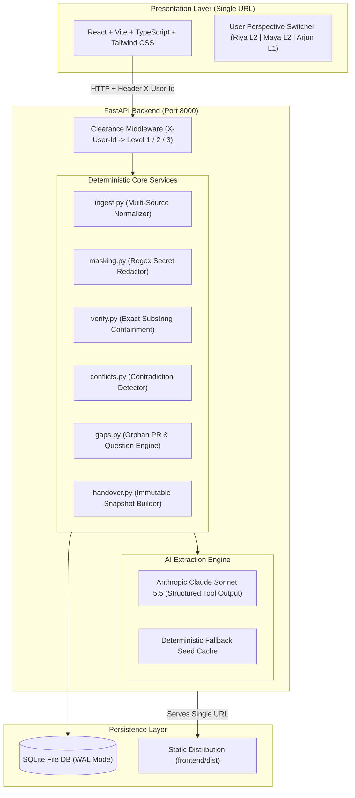

# HandoverTrail

> **An evidence-first, permission-aware knowledge handover platform that turns chaotic engineering transitions into verified, role-tailored institutional memory.**

[](LICENSE)
[](https://fastapi.tiangolo.com)
[](https://react.dev)
[](https://vitejs.dev)
[](https://python.org)
[](https://anthropic.com)

---

## 1. The Problem

When a key engineer resigns, months of undocumented architectural decisions, tribal knowledge, unreviewed pull requests, and hidden single points of failure walk out the door.

Existing AI summarization tools fail catastrophically in engineering handover:
- **Hallucinations**: Generative LLMs present plausible guesses as verified facts.
- **Permission Leaks**: Chat logs containing compensation talks, HR transition notes, or production secrets are exposed indiscriminately to incoming junior engineers.
- **No Verification**: Successors have no way to trace a stated policy back to the exact code review or meeting consensus where it was decided.
- **Uncontrolled Publishing**: Raw AI summaries are dumped directly onto successors without lead verification or sign-off.

---

## 2. The Solution & Features

HandoverTrail ingests project exports (Git, Jira, Meeting Notes, Slack), extracts structured claims (decisions, tasks, risks, dependencies, open questions, contacts), deterministically verifies every claim against exact source quotes, quarantines conflicts, redacts secrets, and requires human lead sign-off before a successor ever sees a word.

| Capability / Feature | Status | Description |
|---|---|---|
| **Multi-Source Ingestion** | **Built** | Normalizes Git issues/PRs/commits, Jira task boards, Markdown notes, and Slack exports. |
| **Server-Side Clearance Boundaries** | **Built** | Strict 3-level clearance (`1=Team`, `2=Lead-Only`, `3=Confidential`). Enforced server-side before return. |
| **Deterministic Quote Verifier** | **Built** | Pure Python engine checks verbatim substring containment. Status `verified` is never hallucinated. |
| **Planted Conflict Quarantining** | **Built** | Detects conflicting statements across sources (e.g. 30-day monthly vs 90-day quarterly key rotation). |
| **Autonomous Secret & PII Masking** | **Built** | Redacts API keys (`sk_live_...`) and phone numbers to `[REDACTED_API_KEY]` and `[REDACTED_PHONE]`. |
| **Knowledge Gap & Leaver Q&A** | **Built** | Automatically synthesizes open questions from abandoned PRs (PR #88 socket leak) and captures leaver answers. |
| **Single-Owner Risk Detection** | **Built** | Flags critical modules authored solely by the departing engineer (e.g. Stripe payment reconciliation). |
| **Lead Approval Gate** | **Built** | Freezes immutable versioned snapshot (`1.0.0`). Only leads can approve. |
| **Successor Onboarding & Acknowledgement** | **Built** | Role-tailored view for successors with cryptographic acknowledgement logging. |
| **Immutable Audit Trail** | **Built** | Tamper-evident log of all extractions, edits, approvals, and acknowledgements. |
| **Citations-Only Q&A (`/api/ask`)** | **Round 3** | Interactive assistant answering strictly from approved, permitted content with exact citations. |
| **Automated GitHub PR Ingestion Hook** | **Round 3** | Live webhook integration to ingest repository activities in real-time. |
| **Slack Interactive Sign-off Bot** | **Round 3** | Direct Slack notifications prompting leads and leavers to resolve gaps. |

---

## 3. Architecture



---

## 4. Tech Stack & Architectural Rationale

- **Frontend**:
  - `React 18 + Vite + TypeScript`: Ultra-fast HMR, type safety, and modern bundle optimization.
  - `Tailwind CSS + shadcn/ui patterns`: Clean, accessible, corporate-grade design system.
  - `Recharts`: Visual progress graphs, status breakdowns, and readiness indicators.
  - `Lucide React`: Consistent iconography.
- **Backend**:
  - `Python 3.11 / 3.12 + FastAPI`: High-performance asynchronous API with automatic OpenAPI documentation.
  - `Pydantic v2`: Strict request/response validation and serialization.
  - `SQLAlchemy 2 + SQLite`: File-based SQLite with WAL mode for zero-setup local execution and single-instance cloud hosting.
  - `pytest + pytest-asyncio`: End-to-end regression and permission test suites.
- **AI & Trust**:
  - `Anthropic Claude Sonnet 5.5`: Structured extraction with strict JSON-schema tool outputs.
  - `Deterministic Verifier`: Pure Python verification — **no LLM grades its own homework**.
- **Deployment**:
  - Single Render/Railway web service: FastAPI serves the compiled React distribution from `frontend/dist` with client-side SPA routing fallback. Evaluators need only one URL.

---

## 5. Quick Start (Get Running in 60 Seconds)

### Prerequisites
- Python 3.11 or 3.12 (`python3.12 -m venv venv`)
- Node.js v18+ and npm

### One-Command Setup
```bash
# Clone repository
git clone https://github.com/TchieSharks/handovertrail.git
cd handovertrail

# Complete setup (backend virtualenv + pip + frontend npm)
make setup
```

### Run Locally (Concurrently)
```bash
make dev
```
- Frontend UI: `http://localhost:5173`
- Backend API & OpenAPI Docs: `http://localhost:8000/api/docs`
- Health check: `http://localhost:8000/health`

### Run Backend Tests
```bash
make test
```

### Seed Synthetic Demo Dataset
```bash
make seed
```

---

## 6. Demo Walkthrough ("Start Here" 4 Steps)

### Step 1: Ingest & The Three Clearance Realities
1. Open `http://localhost:5173`.
2. Notice the top-right user pill is set to **Maya Patel (Lead, Clearance Level 2)**.
3. Click **"Reset Demo"** to load the synthetic CampusConnect project (52 evidence units).
4. Switch to **Arjun Rao (Successor, Clearance Level 1)**.
   - Watch the Level 2 HR transition thread disappear completely from the view. The server filtered it out before dispatching the response.

### Step 2: Run Extraction & Deterministic Verification
1. Switch to **Riya Sharma (Leaver)** and click **"Run Extraction"**.
2. Notice status badges:
   - **Green (`Verified`)**: Exact source quote matched character-for-character in the ingested evidence.
   - **Yellow (`Inferred`)**: Extracted assertion without verbatim source quote.
   - **Red (`Conflicting`)**: Planted contradiction detected.

### Step 3: Resolve Planted Conflict & Abandoned PR
1. Filter claims by **"Conflicting"**:
   - Inspect **Claim #4**: Issue #42 says 30-day monthly rotation; Architecture Meeting says 90-day quarterly rotation.
2. Maya clicks to confirm quarterly rotation.
3. Inspect **Knowledge Gaps**:
   - Review the open gap on **PR #88** (WebSocket connection leak). Riya documents the SSE fallback in PR #94.

### Step 4: Final Sign-off & Successor Onboarding
1. Maya reviews the readiness percentage and approves handover version `1.0.0`.
2. Switch back to **Arjun Rao (Successor)**:
   - Handover tab unlocks with clean, role-appropriate documentation.
   - Arjun clicks **"Acknowledge Handover"**.
   - Review the immutable audit log under `/api/audit`.

---

## 7. How the Trust Model Works

1. **Permission-Before-Generation**:
   - Evidence units above a user's clearance level are stripped *before* entering LLM context and before returning over the network.
   - Confidential Level 3 secrets (e.g. `sk_live_...` and phone numbers) are masked deterministically.
2. **Deterministic Verification**:
   - The status `verified` is granted strictly by string containment:
     $$\text{status} = \begin{cases} \text{verified} & \text{if } \text{normalize}(\text{quote}) \subseteq \text{normalize}(\text{evidence}) \\ \text{inferred} & \text{otherwise} \end{cases}$$
3. **Lead Approval Gating**:
   - No draft claim or unverified inference can be viewed by successors until an authorized lead confirms the claims and freezes an immutable version snapshot.

---

## 8. Project Structure

```
handovertrail/
├── README.md               # Project documentation & guide
├── LICENSE                 # MIT License
├── Makefile                # make setup, dev, build, test, seed
├── .env.example            # Environment template
├── .gitignore              # Clean ignore rules
├── render.yaml             # Render single-service deployment
├── docs/
│   ├── CONTRACT.md         # Single source of truth API & data contract
│   ├── ARCHITECTURE.md     # In-depth architectural design
│   ├── TESTING.md          # Test strategy & synthetic scenario tests
│   ├── CHANGES_FROM_PLAN.md# Architectural decisions & adjustments
│   ├── ROUND3.md           # Round 3 pitch & demo script
│   └── AI_DISCLOSURE.md    # AI and tools disclosure
├── backend/
│   ├── app/
│   │   ├── main.py         # FastAPI application & static mounting
│   │   ├── config.py       # Pydantic settings
│   │   ├── db.py           # SQLAlchemy 2 engine & session
│   │   ├── models.py       # Database models
│   │   ├── schemas.py      # Pydantic v2 schemas
│   │   ├── security.py     # Clearance & X-User-Id resolution
│   │   ├── routers/        # Routers for all CONTRACT.md endpoints
│   │   ├── services/       # Core business logic & verifiers
│   │   └── fixtures/       # Database seed data loader
│   ├── tests/              # pytest test suite
│   └── requirements.txt    # Python dependencies
├── data/
│   └── demo/
│       ├── DATASET_SPEC.md # Specification of 52 evidence units
│       ├── github_export.json
│       ├── tasks.csv
│       ├── meeting_notes.md
│       └── slack_export.json
└── frontend/
    ├── src/
    │   ├── App.tsx         # Dashboard with user switcher & claims view
    │   ├── main.tsx        # React entrypoint
    │   ├── index.css       # Tailwind CSS
    │   └── types/          # TypeScript interfaces
    ├── package.json
    ├── vite.config.ts
    └── tailwind.config.js
```

---

## 9. Honest Limitations

- **Simulated Auth via Header**: For hackathon speed and zero-friction evaluator testing, user identity is switched via the `X-User-Id` header rather than OAuth2 SSO or session cookies.
- **Single-Node SQLite**: File-based SQLite with WAL mode is designed for single-node deployments; horizontal scaling requires migrating to PostgreSQL.
- **Substring Normalization**: Verifier matches case-insensitive normalized substrings; it does not yet perform semantic synonym matching (by design, to avoid semantic drift).

---

## 10. Roadmap

- [x] Multi-source ingestion & normalization
- [x] Server-side clearance boundaries (Levels 1, 2, 3)
- [x] Deterministic quote verifier & conflict detector
- [x] Lead approval gating & frozen snapshots
- [ ] Round 3: Live GitHub PR webhook listener
- [ ] Round 3: Slack Bot for interactive leaver Q&A
- [ ] Enterprise: SAML / Okta SSO integration with automated HR leaver triggers

---

## 11. Team TchieSharks

- **Ashrit Anshuman Pradhan** - System Architecture, Backend & Verifier Engine
- **Kush Tayal** - Frontend UI/UX, Component Architecture & Analytics
- **Amreesh Sharma** - Data Engineering, Synthetic Planted Dataset & Security Audits

For details on tools and AI models used during development, see [docs/AI_DISCLOSURE.md](docs/AI_DISCLOSURE.md).
