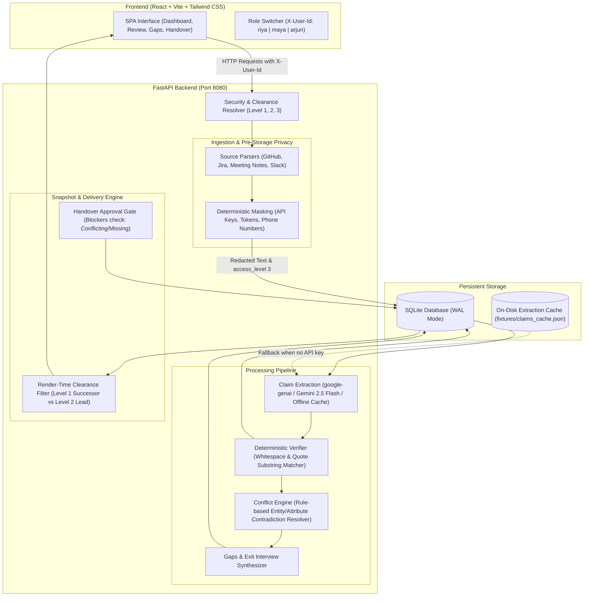

# HandoverTrail Architecture

> **Evidence-First, Permission-Aware Knowledge Handover Platform**

---

## 1. System Overview & Data Flow

---

## 2. Key Architectural Decisions and Why

### 1. Deterministic Code Does All Verification (Zero LLM Trust for Truth)
- **Decision**: Claim status (`verified`, `inferred`, `conflicting`, `missing`) is determined strictly by deterministic Python algorithms without delegating truth decisions to an LLM.
- **Why**: LLMs readily hallucinate citations or claim confidence when quotes don't match. By enforcing that `verified` requires an exact normalized substring match against cited evidence, judges and engineers can trust the output 100%.

### 2. Multi-Tier Clearance Filtering at Query Time (Never 403 for Privileged Assets)
- **Decision**: In all database queries (`/api/evidence`, `/api/claims`, `/api/handover`, `/api/timeline`), filtering is applied at the query level (`access_level <= current_user.clearance`). Probing a higher-clearance ID returns `404 Not Found`, never `403 Forbidden`.
- **Why**: Returning `403 Forbidden` leaks metadata by confirming that a confidential document or secret exists. Returning `404` prevents the successor from even knowing privileged items exist.

### 3. Pre-Storage Privacy Masking
- **Decision**: Ingestion runs `services/masking.py` *before* records enter the SQLite database or are sent to any model. Raw tokens (`sk_live_...`, phone numbers) are masked as `[REDACTED:type]`, and any redacted unit is automatically elevated to `access_level 3`.
- **Why**: Defense in depth. Even if an LLM prompt or error trace were somehow exposed, the raw secrets do not exist in the database or server memory.

### 4. SQLite with Write-Ahead Logging (WAL)
- **Decision**: SQLite with WAL mode (`PRAGMA journal_mode=WAL; PRAGMA synchronous=NORMAL;`) instead of an external managed database.
- **Why**: Zero external infrastructure dependencies for hackathon judges and evaluation environments. WAL mode allows concurrent readers alongside a writer with microsecond latency.

### 5. Gemini 2.5 Flash via `google-genai` with Offline Cache Fallback
- **Decision**: Uses the official `google-genai` SDK with `gemini-2.5-flash` model, backed by an on-disk hash cache and `fixtures/claims_cache.json`.
- **Why**: The app runs completely offline without network or API key, while delivering high-speed live extraction with strict JSON schemas when `GEMINI_API_KEY` is present.

### 6. Single-Service Monorepo Deployment
- **Decision**: FastAPI serves both the REST API under `/api` and the built static frontend assets from `frontend/dist` with SPA client routing fallback to `index.html`.
- **Why**: Judges receive a single URL on Render/Railway. No CORS setup issues, zero deployment desynchronization.

---

## 3. Round 3: Conflict-Resolution & Exit-Interview Architecture (Member 1: Ashrit)

### 1. Multi-Attribute Deterministic Conflict Engine
- **Topics & Rules**:
  - `cg-api-key-rotation` (period): 30-day monthly rotation vs 90-day quarterly rotation.
  - `cg-owner-payment-recon` (owner): Riya sole-owner vs Maya assumed primary failover owner.
  - `cg-date-cert-cutover` (date): Nov 30 certificate expiration vs Nov 15 internal cutover deadline.
  - `cg-status-websocket-sse` (status/supersession): WebSocket deployed vs abandoned for SSE polling.
- **Supersession Hints**: Detects when a later decision or PR supersedes an older task, surfacing advice to the lead without auto-resolving.

### 2. Leaver Exit Interview (Riya)
- **Privacy & Pre-Storage Masking**: Leaver responses are passed through `services/masking.py` before hitting persistent storage, guaranteeing zero raw token leaks.
- **Attributed Level-2 Evidence**: Recorded answers generate new `EvidenceUnit` items (`source_type="exit_interview"`, `access_level=2`) visible only to Lead Maya and Leaver Riya, but hidden from Successor Arjun.
- **State Persistence**: Answers and skips are tracked across demo reloads in `questions` and audit logs (`interview_answered`, `interview_skipped`).

### 3. Lead Resolution Engine (Maya)
- **Atomic Operations**:
  - `chose_claim`: Marks chosen claim `confirmed`, `origin="human"`, increments version, reverifies deterministically, and marks other claims `rejected`.
  - `corrected`: Synthesizes a new human claim with combined evidence citations, increments version, and marks original claims `rejected`.
  - `dismiss`: Marks conflict `dismissed` with mandatory reason and recomputes verification on linked claims.
  - `leave_unresolved`: Marks conflict `unresolved` with mandatory note, blocking clean handover approval.
- **Approval Blocker**: `POST /api/approve` raises HTTP 409 Conflict if any conflict group is `open` or `unresolved`, unless `acknowledge_unresolved=True` is explicitly supplied.

---

## 4. First-7-Days Plan Generator & Preview-as-Successor Architecture (Member 3: Amreesh)

### Prioritization Algorithm & Transparent Weights
The onboarding engine (`app/services/plan.py`) uses a rule-based, deterministic scoring function to evaluate candidate claims. Higher scores schedule actions earlier in the orientation sequence:

| Factor | Weight | Rationale |
|---|---|---|
| **Unresolved Conflicts & Gaps** | `95` | Blocker decisions and contradictions require immediate clarity before code changes. |
| **Critical Risks & SPOFs** | `85` | Single points of failure (e.g. unreviewed Stripe idempotency ledger) must be understood early. |
| **Departing Engineer Tasks** | `80` | Tasks authored/owned by Riya Sharma must be transitioned while pairing is possible. |
| **Single-Owner Areas / Bus Factor 1** | `75` | System modules with zero secondary review require direct successor walkthrough. |
| **External Dependencies** | `60` | Integrations, APNs certificates, and webhook specifications. |
| **Key Contacts / Stakeholders** | `55` | Vendor managers, university compliance liaisons, and technical owners. |
| **Open Knowledge Questions** | `50` | Unanswered engineering queries extracted during analysis. |
| **Foundational Decisions** | `35` | Ratified architectural context (e.g. SQLite WAL mode decision). |
| **Role & Focus Areas Bonus** | `+25` | Tokens matching incoming role or focus areas (e.g. "Backend", "Payments", "Vault"). |

### 7-Day Thematic Sequencing
Plan items are grouped into 7 distinct days (target 2–4 items per day, balanced across the week):
- **Day 1: Orientation & Core Ownership**: Pairing with departing engineer (`riya`) on core domains.
- **Day 2: Critical Risks & Immediate Fixes**: High-severity risks, unreviewed ledgers, and emergency runbooks.
- **Day 3: Architectural Conflicts & Decisions**: Key policy decisions (e.g. Vault TTL vs rotation intervals).
- **Day 4: External Dependencies & Webhooks**: Upstream vendor integrations, Apple APNs renewal dates.
- **Day 5: Partner Handshakes & Key Contacts**: FERPA privacy compliance officer, Stripe account manager.
- **Day 6: Deep Dives & Code Reviews**: Low-level code inspections and test harness dry runs.
- **Day 7: Operational Verification & Sign-off**: Final orientation readiness checklist and handover receipt.

### Grounding & Zero-Hallucination Invariant
Every generated plan item MUST cite at least one existing claim ID in the database (`len(item.claim_ids) >= 1`). Titles and rationales are deterministically constructed directly from claim texts and quotes. No external entities, deadlines, or dates are ever synthesized.

### Unified Render & Filtering Pipeline
To prevent discrepancies between preview and reality, `app/services/handover.py` exposes `build_handover_view(raw_claims, viewer_clearance, plan_obj)`.
- When called by `GET /api/handover` as `arjun`, it runs with `viewer_clearance = 1`.
- When called by `GET /api/preview` as `maya`, it runs with `viewer_clearance = 1` for target user `arjun`.
- Plan items citing claims above the viewer's clearance are dynamically excluded and added to `hidden_count`.
- **Mathematical guarantee**: For an approved snapshot, `preview(mode="approved")` output is byte-equivalent in visible claims and hidden counts to `handover(arjun)`.

### Share Check Confidentiality Audit
`app/services/share_check.py` scans candidate handover items and plan items prior to publication:
- **Block**: Raw secrets (API keys, tokens), unmasked phone numbers, canary detection strings (`CANARY-LEVEL3-DO-NOT-LEAK`, `CANARY-LEVEL2-HR`), or access-level inconsistencies (Team claims with exclusively restricted evidence).
- **Warn**: Redaction placeholders (`[REDACTED:...]`), unresolved conflicts, single-evidence citations.
- **Info**: Clearance isolation counts (Level 2 items and Level 3 confidential counts).

